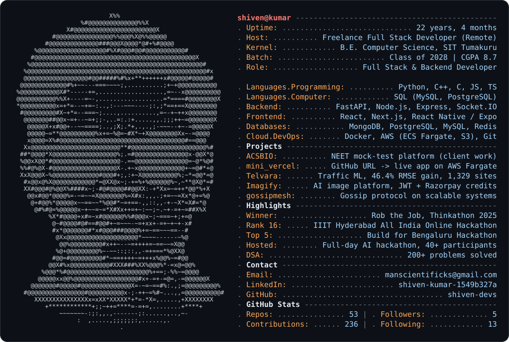

  <picture>
    <source media="(prefers-color-scheme: dark)" srcset="dark_mode.svg">
    <source media="(prefers-color-scheme: light)" srcset="light_mode.svg">
    
  </picture>

  <a href="https://www.linkedin.com/in/shiven-kumar-1549b327a">LinkedIn</a> &nbsp;·&nbsp;
  <a href="mailto:manscientificks@gmail.com">Email</a> &nbsp;·&nbsp;
  <a href="https://github.com/shiven-devs?tab=repositories">All repositories</a>

